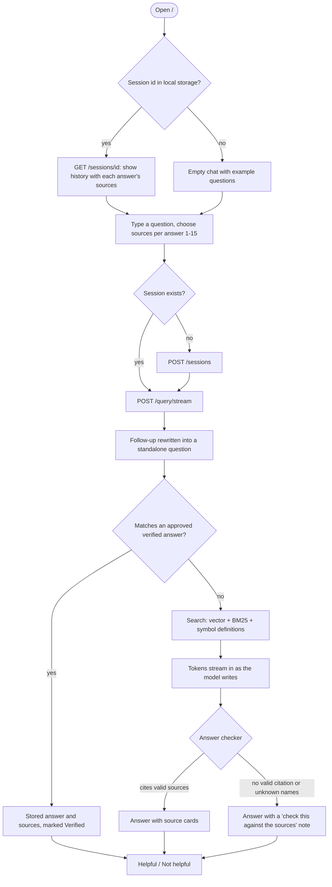
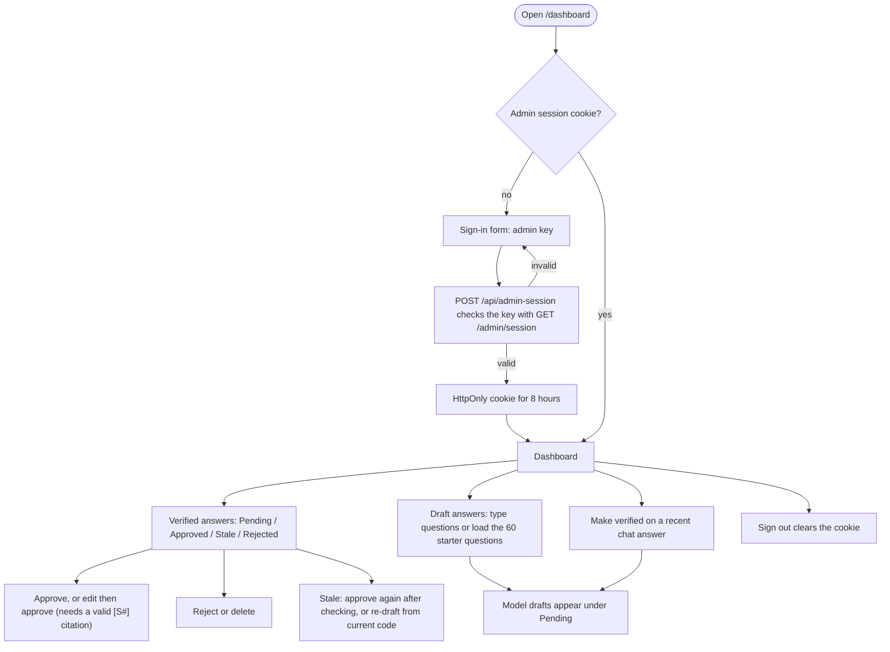

# App Flow

**Project:** Sentinel
**Status:** Built. Describes the flows as implemented on 2026-10-19 and checked in a browser (desktop and 390 px phone width).
**Related:** [`04_UI_UX_DESIGN_BRIEF.md`](04_UI_UX_DESIGN_BRIEF.md) · [`05_BACKEND_SCHEMA.md`](05_BACKEND_SCHEMA.md) · [`06_IMPLEMENTATION_PLAN.md`](06_IMPLEMENTATION_PLAN.md)

## 1. Screens

| Screen | Path | Who can see it |
|---|---|---|
| Chat | `/` | Everyone who can reach the site |
| Documents | `/documents` | Everyone who can reach the site |
| Dashboard | `/dashboard` | Admin only. Everyone else gets the admin sign-in form, and the header shows no Dashboard link |

The browser only ever calls the Next.js proxy under `/api/*`. The proxy adds a regular API key for normal routes, and forwards `/api/admin/*` only with the admin's own key from the session cookie.

## 2. Asking a question

- **Streaming transport:** `POST /query/stream` read with `fetch` and a streamed body, not `EventSource`, because `EventSource` cannot send a header and only supports GET.
- **Sources:** each answer carries its own source cards. A verified answer shows the sources approved with it.
- **Errors:** a failed request renders as a red message bubble inline in the thread. Stop aborts the stream and keeps what already arrived.
- **Filters:** a question sent with a language, path prefix or retrieval mode skips the verified-answer database, because the stored answer may not respect the filter.

## 3. Uploading a document

- **Entry:** the Documents page, never automatic and never blocking the chat.
- **Accepts:** `.py .md .mdx .js .jsx .ts .tsx .txt .pdf .docx`, up to 10 MB, by drag-and-drop or file picker.
- `POST /documents/upload` answers at once with a job id. The page shows Queued → Processing → Indexed (or "Already indexed, no change", or Failed with the reason) by polling `GET /jobs/{id}`.
- The list below has two views: **Uploaded** (each with a Remove button) and **Codebase** (the indexed corpus files, read-only, because the next sync would restore anything removed).

## 4. Administrator flows

- **Dashboard contents:** service status, usage tiles, questions per day, retrieval quality per eval run, recent questions, the verified-answer review queue, eval history, codebase index and sync runs, uploads, system details, and the project plan read from `06_IMPLEMENTATION_PLAN.md`. It refreshes every 20 seconds.
- **An expired or revoked admin key** returns the dashboard to the sign-in form.
- **Syncing the codebase** is an admin API call (`POST /admin/sync?pull=true`), shown on the dashboard with its results. The dashboard does not start a sync itself.

## 5. Explicit non-flows

- No user accounts or login for chat. Auth is an API key held by the server; the only sign-in is the admin's.
- No settings screen beyond the sources-per-answer slider.
- No in-app management of API keys. That stays on the admin API (`/admin/keys`).
