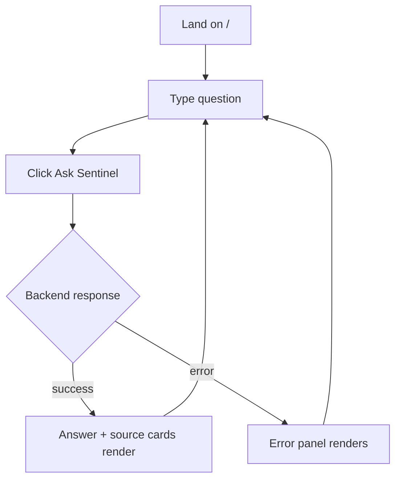
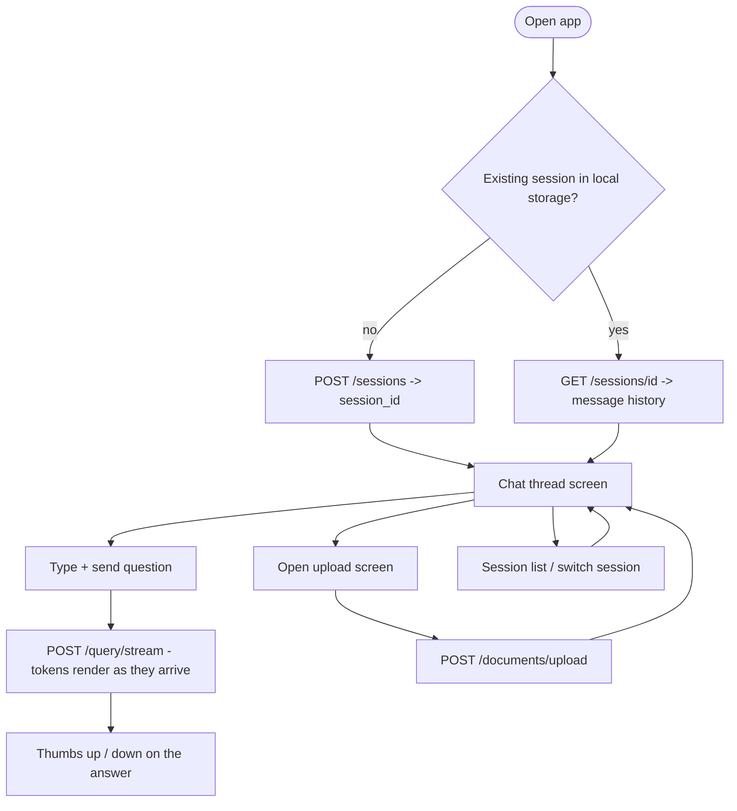

# App Flow

**Project:** Sentinel
**Status:** Target-state design, written against the schema in [`05_BACKEND_SCHEMA.md`](05_BACKEND_SCHEMA.md) — navigation and state below assume that schema exists, even though it isn't built yet
**Related:** [`04_UI_UX_DESIGN_BRIEF.md`](04_UI_UX_DESIGN_BRIEF.md) · [`06_IMPLEMENTATION_PLAN.md`](06_IMPLEMENTATION_PLAN.md)

## 1. Current state (v1 — what exists today)

One screen, no navigation, no session concept.

## 2. Target state (post Phase 6 + Phase 8)

Three screens, session-aware, matching the `sessions`/`messages` tables in the schema doc.

## 3. Screen-by-screen

### Chat thread (replaces today's single Q&A block)

- **Entry:** app load. Resumes the last active session from local storage if one exists; otherwise creates a new one via `POST /sessions`.
- **Shows:** full message history, user and assistant turns interleaved. Each assistant turn carries its own source cards attached to that specific turn — not one global source panel like today, since multiple turns will have different sources.
- **Streaming transport:** `POST /query/stream` consumed with `fetch` and a streamed body, not `EventSource`. `EventSource` cannot send the `X-API-Key` header that Phase 7 requires, and it only supports GET.
- **Top-k control:** a slider, 1-15. No backend change required — `QueryRequest.top_k` already has that exact `ge`/`le` constraint, this just exposes it in the UI.
- **Error handling:** once there's a scrolling history, an error must render as a failed message bubble inline in the thread, not a page-level banner. Today's page-level error panel is correct for a single-Q&A screen and stops being correct the moment there's a history to scroll past it.

### Upload

- **Entry:** explicit navigation from the chat screen — never automatic, never blocking the chat flow.
- **Accepts:** `.py`, `.md`, `.pdf`, `.docx`, `.txt` via drag-and-drop or file picker.
- **Submits to** `POST /documents/upload`, which per the TRD and Implementation Plan responds immediately with a job id (background task, not a blocking request). The UI shows a "processing" state and polls `GET /jobs/{id}` (the `jobs` table in the schema doc), rather than holding a blocking spinner — ingesting a real file is not fast, and rule 8.1 in `docs/CONTEXT.md` already mandates the backend never blocks on it. The frontend flow has to honor that, not fight it with a spinner that implies "almost done."

### Session history

- **Entry:** from the chat screen, a simple list of past sessions.
- **Lets a user** resume or start a new session. No sharing or multi-user access control in scope — consistent with the "no `users` table" decision in the schema doc. If that decision changes, this screen changes with it.

## 4. Explicit non-flows

Things this app deliberately does not do in this version, so they don't get built by accident while implementing something adjacent:

- No account creation or login screen. Phase 7 auth is an `X-API-Key` header, not a UI flow.
- No settings screen beyond the inline top-k slider — nothing else is user-configurable yet.
